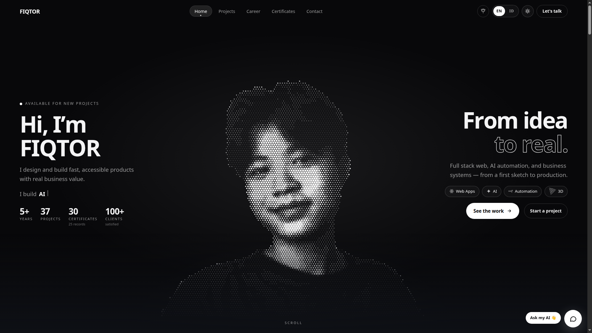

<div align="center">

# FIQTOR Portfolio — v3

**A dark-first, motion-rich personal portfolio template**
built with React 19 · TypeScript · Vite — bilingual, SEO/AEO/GEO-ready, and easy to make yours.

[](https://github.com/FIQTOR/fiqtor.com/generate)
[](https://fiqtor.com)
[](./LICENSE)

</div>



<sub><a href="https://fiqtor.com">Live demo</a> · screenshots captured from the real site. Swap them for your own after rebranding (see <a href="#make-it-yours">Make it yours</a>).</sub>

---

## What you get

This is a **complete, production-grade portfolio** you can clone, rebrand, and ship in an
afternoon. Nothing is tied to the author — all identity, content, and copy live in a handful
of plain TypeScript files.

| | Feature |
| --- | --- |
| 🎨 **Distinctive design** | Dark canvas, dot grid, oversized typography, one-click **monochrome light theme** |
| ✨ **Motion system** | GSAP hero intro, column-curtain page transitions, scroll reveals, magnetic buttons, interactive dot portrait — all respect `prefers-reduced-motion` |
| 🌍 **Trilingual (EN / ID / ZH)** | Every string is localized across English, Indonesian, and Simplified Chinese; a language switch in the navbar and `<head>` `hreflang` |
| 🗂️ **Real content catalogue** | 37 projects, 30 certificates (49 credential items), 4 career roles, 9-currency dynamic price converter — filterable, searchable, with a detail modal + gallery lightbox |
| 🔌 **Live integrations** | AI assistant (SSE streaming), contact form (reCAPTCHA), GitHub contributions, WakaTime, crypto prices, social stats — each **degrades gracefully** if the backend is down |
| 🔎 **SEO · AEO · GEO** | Per-route static HTML, `sitemap.xml`, `robots.txt`, JSON-LD (`Person`, `FAQPage`, `HowTo`, `ItemList`…), `llms.txt` / `llms-full.txt` |
| 📱 **Mobile-audited** | 320–430px safe, bottom-sheet modals, iOS-safe inputs, ≥2.9rem tap targets |
| ⚡ **Fast** | Vite 8, route-level lazy loading, code-split vendors, lazy images with explicit dimensions |
| 🚀 **Deploy anywhere** | Ready-made configs for **Cloudflare Pages**, **Vercel**, or any static host |

---

## Quick start

```bash
# 1 · clone (or click "Use this template" on GitHub)
git clone https://github.com/FIQTOR/fiqtor.com.git my-portfolio
cd my-portfolio

# 2 · install & configure
npm install
cp .env.example .env         # set VITE_DOMAIN / VITE_API_BASE_URL (no backend yet? leave defaults)

# 3 · run
npm run dev                  # → http://localhost:5173
```

> **No backend? Still fine.** Every live widget (AI, stats, prices) falls back to sensible
> local defaults, so the site looks and works complete without `VITE_API_BASE_URL`.

### Scripts

| Command | What it does |
| --- | --- |
| `npm run dev` | Vite dev server with HMR |
| `npm run build` | Typecheck (`tsc -b`) + production build → `dist/` |
| `npm run preview` | Serve the production build locally |
| `npm run lint` | Lint with [oxlint](https://oxc.rs/) |
| `npm run typecheck` | TypeScript project build, no emit |

**Requirements:** Node **20+** and npm 10+.

---

## Make it yours

> Everything below is **content only** — you never have to touch components or CSS to rebrand.

### 1 · Identity — `src/config/Identity.ts` ⭐ start here

The single source of truth for who the site is about. Set your name, brand, role, headline,
contact details, socials, timezone, résumé paths, company, and portrait.

```ts
export const BRAND_NAME = 'FIQTOR';            // name shown everywhere in the UI
export const LEGAL_NAME = 'Taufiiqul Hakim';   // only in About + structured data
export const JOB_TITLE  = 'AI & Software Engineer';
export const SITE_ORIGIN = 'https://fiqtor.com';
export const SOCIAL_LINKS = { github: '…', linkedin: '…', … };
export const PORTRAIT_IMAGE = '/icon.webp';    // replace public/icon.webp
```

### 2 · Content — `src/data/`

| File | What to edit |
| --- | --- |
| `projects.ts` | Your projects (`title`, `description`, `tags` in EN/ID, `srcImage` + `images[]`, `category`, `best`) |
| `certificates.ts` | Certificates & awards (`published`, `srcImage`, `tags`, `best`) |
| `certificatesExtra.ts` | Longer descriptions shown in the certificate modal |
| `certGroups.ts` | Which certificates are "flagship" and how the rest are grouped |
| `site.ts` | Services, FAQ, process steps, Linktree, career, testimonials, stats |
| `skills.ts` | Skill → icon mapping |
| `social.ts` | Social link labels & icons |
| `galleryLabels.ts` | Screenshot captions |
| `portrait.ts` | Hero dot-matrix interactive face particles (`PORTRAIT: { w, h, d: [[x, y, size], ...] }`) |

> 💡 **Customizing Hero Dot Face (`portrait.ts`):**  
> Mengubah visual dot-matrix wajah di hero section jauh lebih cepat dan rapi jika menggunakan **Claude / AI**. Unggah foto portrait diri dengan kontras jelas, lalu minta Claude membuat array dot matrix `[x, y, size]` yang sesuai dengan interface `PortraitData` di `src/data/portrait.ts`.

**Images** go in `public/img/{projects,career,certificate,cryptocurrency,testimonials}/`
(use `.webp` for speed). **Résumés** go in `public/pdf/`. Then update the paths in `Identity.ts`.

### 3 · Pages & metadata — `src/config/Seo.ts`

Per-route titles, descriptions, keywords, FAQ answers, and structured data (`ROUTES`, `FAQ`).
This module is *pure*, so it powers both the build-time `<head>` **and** client-side SPA
navigation — edit it once.

### 4 · Theme — `src/styles/site.css`

Both themes are plain CSS custom properties on `html[data-theme="dark"|"light"]`. Recolor the
whole site by editing those variables — no build step, no Tailwind config.

### 5 · Environment — `.env`

| Variable | Purpose |
| --- | --- |
| `VITE_DOMAIN` | Site origin for canonical / OG / JSON-LD URLs |
| `VITE_API_BASE_URL` | Backend for live widgets (see [backend contract](#live-integrations-backend-contract)) |
| `VITE_ENABLE_AI` | `false` hides the AI assistant button |
| `VITE_RECAPTCHA_SITE_KEY` | Empty = reCAPTCHA widget off |
| `VITE_GA_ID` | GA4 measurement ID override (falls back to `GA_MEASUREMENT_ID` in `Identity.ts`) |

> ⚠️ **`VITE_*` values are embedded in the public bundle.** Never put secrets there — API keys,
> tokens, and private credentials belong on the backend.

### 6 · Before you publish — checklist

- [ ] `Identity.ts` — name, contact, socials, domain, résumé paths
- [ ] Replace `public/icon.webp`, `public/favicon.ico`, `public/img/icons/*`, `public/og-image.png`
- [ ] Remove or replace `public/googled*.html` (Google Search Console verification — **not yours**)
- [ ] Clear the sample catalogue in `src/data/projects.ts` / `certificates.ts`
- [ ] Update `GA_MEASUREMENT_ID` in `Identity.ts` — or set it to `''` to disable analytics
- [ ] Update `<title>` fallbacks and JSON-LD by editing `src/config/Seo.ts`
- [ ] Replace `docs/preview.png` with a screenshot of your own homepage hero
- [ ] Update the repo/`package.json` name and the `LICENSE` copyright line

### Replacing the README thumbnail

`docs/preview.png` is a real capture of the live demo, so it still shows the author's name.
After rebranding, capture your own homepage hero at **1920×1080** (open your deployment, scroll
to the top, wait for the intro animation to settle, then screenshot the visible area) and save it
over `docs/preview.png`. Keep the filename and the README picks it up with no edits.

---

## Project structure

```
index.html                       # shell; <head> injected at build time
vite.config.ts                   # React plugin + build-time SEO/sitemap/llms plugin
docs/preview.png                 # README hero thumbnail (replace with your own)
public/
  img/{projects,career,certificate,cryptocurrency,testimonials}/  # your screenshots
  pdf/                           # résumés
  icon.webp, og-image.png        # portrait & social preview
  img/icons/                     # PWA icons (192, 512, maskable, apple-touch)
  _headers, _redirects           # Cloudflare Pages housekeeping
src/
  main.tsx                       # router (Home, Projects, Career, Certificates, Contact, Linktree, 404)
  styles/site.css                # the entire visual system + theme tokens
  config/
    Identity.ts                  # ★ brand, owner, contact, socials, résumé paths
    Api.ts                       # VITE_API_BASE_URL validation
    Features.ts                  # reCAPTCHA / AI feature flags
    Seo.ts                       # ★ per-route meta + JSON-LD + sitemap/robots/llms/manifest
  data/                          # ★ all content (bilingual)
    site.ts                      # services, FAQ, process, linktree, career, catalogue
    projects.ts, certificates.ts # catalogues (EN/ID)
    certGroups.ts                # certificate taxonomy (flagship → grouped)
  components/
    Layout, Loader, Navbar, Footer, Logo, ThemeSwitch, GlobalEffects, DotPortrait
    Cards, DetailModal, FilterGallery, Seo, home/{Hero,HomeSections,LiveStats}
  lib/
    catalog.tsx                  # modal state + LanguageProvider
    chat.tsx                     # AI assistant (SSE streaming + local fallbacks)
    theme.tsx, themeBoot.ts      # dark/light provider + pre-paint script
    ui.tsx, utils.ts, utils.tsx  # toasts, motion prefs, pure helpers, icons
  hooks/useReveal.tsx            # scroll reveal, interactive titles, count-up, typewriter
  pages/                         # one file per route
```

The `★` files are the ones you'll edit most — identity, content, and metadata.

---

## Live integrations (backend contract)

All network calls target `VITE_API_BASE_URL` (default `http://localhost:4000/api`) and
**degrade gracefully** — if the backend is unreachable, the UI keeps working with local
defaults. Point them at your own API, or leave `VITE_ENABLE_AI=false` and skip most of it.

| Feature | Endpoint | Notes |
| --- | --- | --- |
| AI assistant | `POST /v1/ai/generate` | Streams `text/event-stream`; `{text}`, `{type:'redirectLocal',url}`, `{type:'redirect',platform}` |
| Contact form | `POST /v1/contact/send` | JSON `{name,email,wa,type,budget,timeline,message,captcha}` |
| GitHub contributions | `GET /v1/github/contributions` | Homepage heatmap uses the public contributions API directly |
| WakaTime | `GET /v1/wakatime` | `data.text` + `data.range.start_text` |
| Crypto prices | `GET /v1/crypto` | `{btc,eth,sol}` with `rate` + `delta.day\|month` |
| Social stats | `GET /v1/social/stats` | Follower counts (TikTok / Instagram) |

Only the endpoints you use need to exist — unused widgets fall back to static content.

---

## SEO · AEO · GEO out of the box

Everything is generated from one pure module, `src/config/Seo.ts`, used twice: by
`vite.config.ts` at build time (static HTML per route) and by `<Seo />` at runtime (SPA nav).

- **SEO** — per-route title/description/canonical/OG/Twitter, `hreflang` (`en`, `id`, `x-default`),
  `sitemap.xml` with `xhtml:link` alternates, `robots.txt`, `security.txt`, web manifest, and a
  static `/<route>/index.html` so crawlers and hard refreshes get correct metadata without JS.
- **AEO** — `FAQPage`, `HowTo`, `ItemList` (services, projects, certificates, roles),
  `BreadcrumbList`, and `SpeakableSpecification`.
- **GEO** — `/llms.txt`, `/llms-full.txt`, and explicit rules for AI crawlers (GPTBot,
  ClaudeBot, PerplexityBot, Google-Extended, CCBot, …) in `robots.txt`.

> The demo ships with Search Console verification and GA4 IDs for `fiqtor.com` — **replace them
> with your own** before going live.

---

## Deploy

The build is a static bundle in `dist/`. Pick a host:

<details open>
<summary><b>Cloudflare Pages</b></summary>

| Setting | Value |
| --- | --- |
| Framework preset | None |
| Build command | `npm run build` |
| Build output directory | `dist` |
| Root directory | `/` |
| Node version | 20+ |

`public/_headers` and `public/_redirects` are already wired. `wrangler.jsonc` and
`functions/_middleware.js` (real 404s for missing assets) only matter if you use the
Cloudflare CLI — update the `name` in `wrangler.jsonc` to your Pages project.
</details>

<details>
<summary><b>Vercel</b></summary>

`vercel.json` already includes SPA rewrites and security headers — just import the repo.
Update the `VITE_DOMAIN` / `VITE_API_BASE_URL` values in its `build.env` block.
</details>

<details>
<summary><b>Any static host</b></summary>

Run `npm run build` and serve `dist/` with an SPA fallback to `index.html` for unknown paths
(the prerendered per-route shells already exist for the main routes).
</details>

**Post-deploy check** — invisible failures like a lost `<meta name="viewport">` (site renders
zoomed-out on phones), missing headers, or 404s on legacy URLs:

```bash
bash scripts/verify-deploy.sh                      # production
bash scripts/verify-deploy.sh https://staging…     # any origin
```

---

## Accessibility & performance

- Respects `prefers-reduced-motion` — loader, hero, cursor effects, and tilt all disable.
- Cursor / tilt / magnetic effects only run on precise-pointer devices.
- Content is visible without JS: reveals, count-ups, and interactive titles are progressive.
- Heavy routes (certificates, contact/reCAPTCHA) are lazy-loaded.
- Images use `loading="lazy"` with explicit dimensions (no layout shift).
- Mobile audited 320–430px: no horizontal overflow, bottom-sheet modals, iOS-safe inputs.

---

## FAQ

<details>
<summary><b>Do I need a backend?</b></summary>

No. The site renders complete without one — AI chat, live stats, prices, and the contact
form simply fall back to local defaults. Add `VITE_API_BASE_URL` when you want them live.
</details>

<details>
<summary><b>Can I make it single-language?</b></summary>

Yes. All copy is stored as `{ en, id }` in `src/data/*`. Keep one key and trim the language
switch in `Navbar.tsx`, or leave both for a bilingual audience.
</details>

<details>
<summary><b>How do I remove the AI assistant or reCAPTCHA?</b></summary>

Set `VITE_ENABLE_AI=false` to hide the AI button; leave `VITE_RECAPTCHA_SITE_KEY` empty to
disable the reCAPTCHA widget. To turn off analytics, set `GA_MEASUREMENT_ID = ''` in
`src/config/Identity.ts`.
</details>

<details>
<summary><b>Where do I change colors and fonts?</b></summary>

`src/styles/site.css` — the theme is a set of CSS custom properties on
`html[data-theme="dark"|"light"]`. Change the tokens, and every component follows.
</details>

<details>
<summary><b>Does it include a blog or CMS?</b></summary>

Not by default. Content is file-based (TypeScript data modules), which keeps the build fast
and the diff reviewable. Fork it and add a blog route if you need one.
</details>

---

## Credits & license

Built by [FIQTOR](https://fiqtor.com). Released under the **MIT License** — free to use,
modify, and ship, including commercially. See [LICENSE](./LICENSE).

If this template helped you, a ⭐ on the repo is appreciated. Remove the `LICENSE`/attribution
only if your fork's license allows it — MIT requires keeping the copyright notice.
